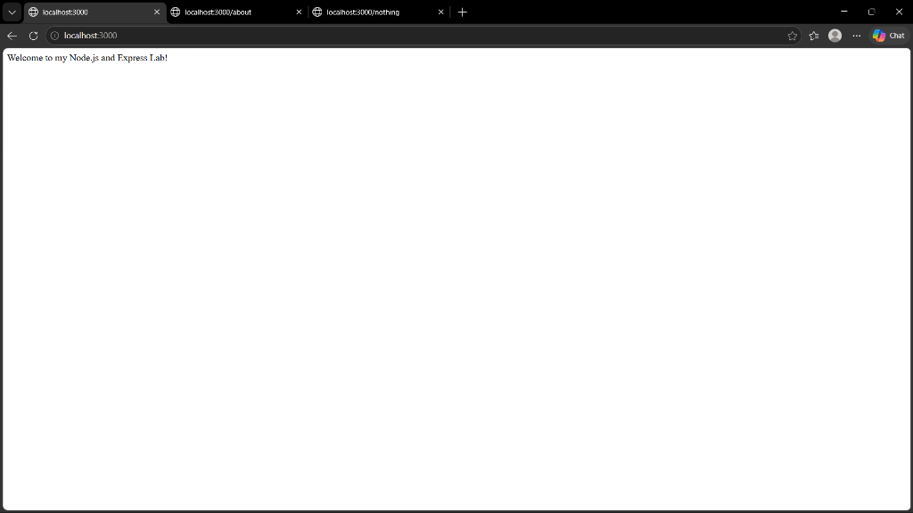
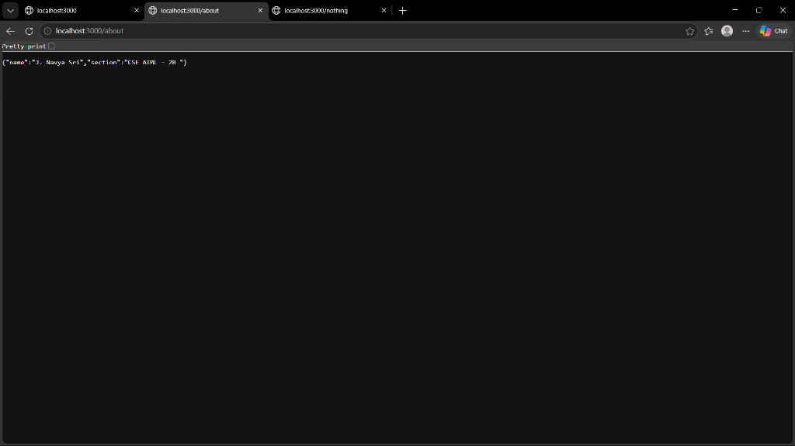
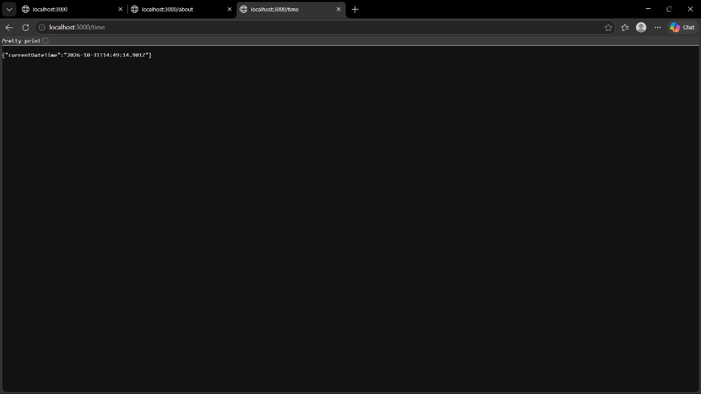
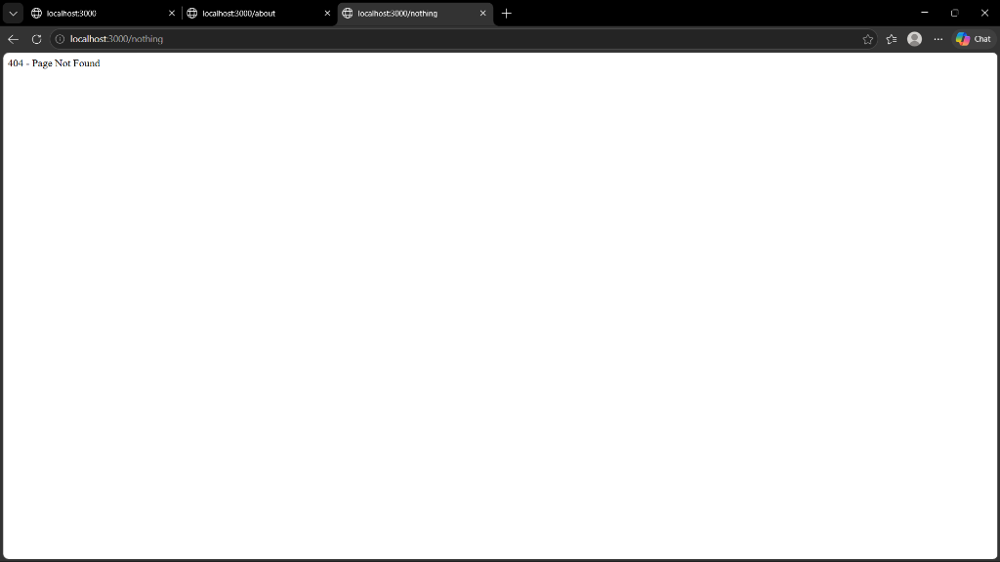

# BDF Lab 01 - Node.js & Express Basics

A foundational backend development lab demonstrating how to build web servers using both Node.js built-in `http` module and the Express.js framework.

---

## 🌐 Live Deployment

🔗 **Live URL:** [https://bakendlabreport1.vercel.app/](https://bakendlabreport1.vercel.app/)

- 🏠 **Home:** [https://bakendlabreport1.vercel.app/](https://bakendlabreport1.vercel.app/)
- 👤 **About:** [https://bakendlabreport1.vercel.app/about](https://bakendlabreport1.vercel.app/about)
- ⏰ **Time:** [https://bakendlabreport1.vercel.app/time](https://bakendlabreport1.vercel.app/time)

---

## 👤 Author Information

- **Name:** J. Navya Sri
- **Section:** CSE AIML - 2B

---

## 📁 Project Structure

```text
BDF-Lab-01/
├── api/                  # Vercel serverless entry point
├── node_modules/         # Installed dependencies (git ignored)
├── screenshots/          # Output and verification screenshots
├── .gitignore            # Git ignore file
├── package.json          # Project metadata & dependencies
├── package-lock.json     # Dependency lockfile
├── plain-server.js       # Basic server using Node.js 'http' module
├── server-http.js        # Express.js server with routes and 404 handler
├── vercel.json           # Vercel deployment & routing config
└── README.md             # Project documentation
```

---

## 🚀 Getting Started

### Prerequisites

Ensure you have [Node.js](https://nodejs.org/) (v18 or higher recommended) installed.

Check versions:
```bash
node -v
npm -v
```

### Installation

Clone the repository and install dependencies:

```bash
git clone https://github.com/jayavarapunavyasri-hash/Lab_report_1.git
cd Lab_report_1
npm install
```

---

## 💻 Running the Servers

### 1. Plain HTTP Server
Runs a lightweight server built with the native Node.js `http` module:

```bash
node plain-server.js
```
- **URL:** [http://localhost:3000](http://localhost:3000)
- **Response:** Plain text `"Hello"`

---

### 2. Express Server
Runs an Express.js server with route handling:

```bash
node server-http.js
```
- **URL:** [http://localhost:3000](http://localhost:3000)

---

## 📡 API Endpoints (Express Server)

| Method | Endpoint | Live Link | Description | Sample Response |
| :--- | :--- | :--- | :--- | :--- |
| `GET` | `/` | [Open /](https://bakendlabreport1.vercel.app/) | Welcome page | `Welcome to my Node.js and Express Lab!` |
| `GET` | `/about` | [Open /about](https://bakendlabreport1.vercel.app/about) | Student / author details | `{"name": "J. Navya Sri", "section": "CSE AIML - 2B "}` |
| `GET` | `/time` | [Open /time](https://bakendlabreport1.vercel.app/time) | Current date and timestamp | `{"currentDateTime": "..."}` |
| `*` | Any other route | [Open /random](https://bakendlabreport1.vercel.app/random) | 404 error handler | `404 - Page Not Found` |

---

## 📸 Screenshots

| Route / Test | Screenshot |
| :--- | :---: |
| **Welcome (`/`)** |  |
| **About (`/about`)** |  |
| **Time (`/time`)** |  |
| **404 Not Found (`/nothing`)** |  |

---

## 🛠️ Built With

- [Node.js](https://nodejs.org/) - JavaScript Runtime
- [Express.js](https://expressjs.com/) - Web framework for Node.js
