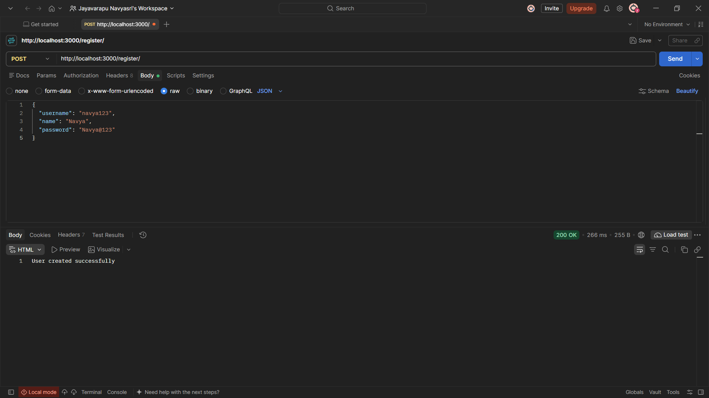
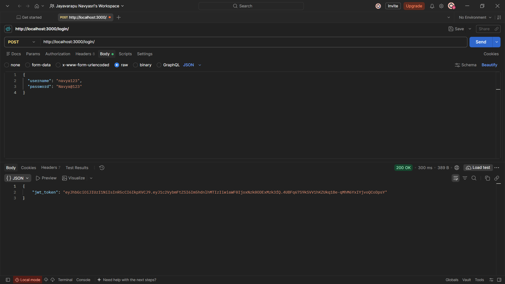
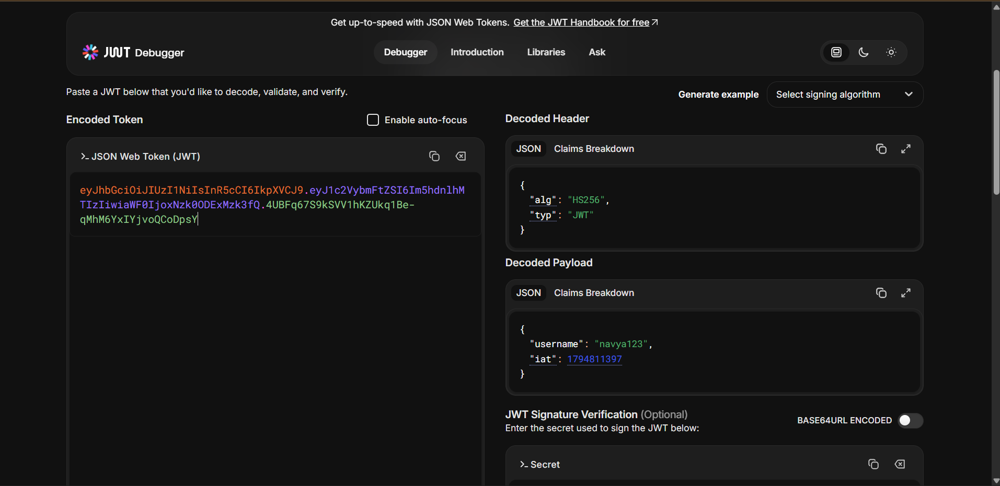
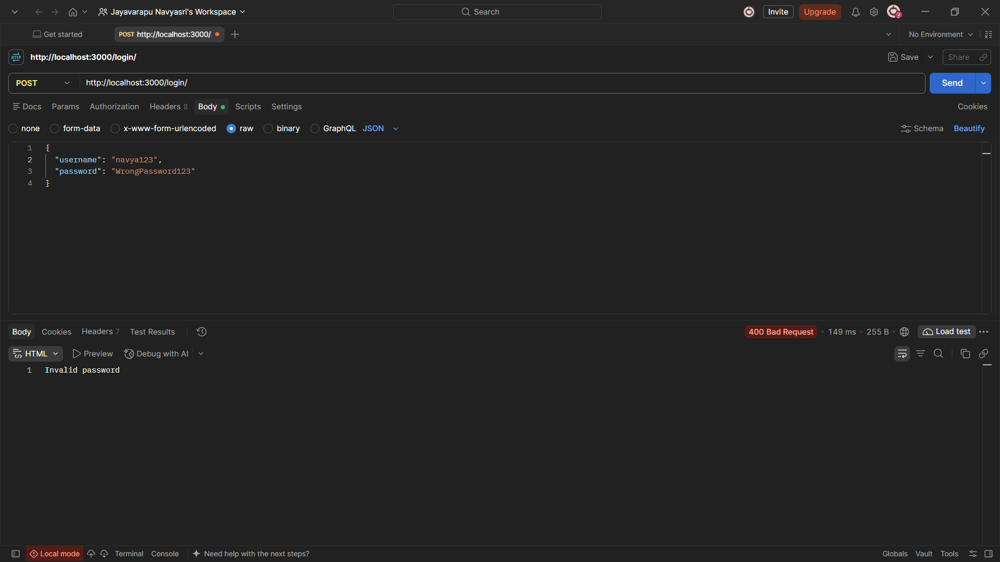
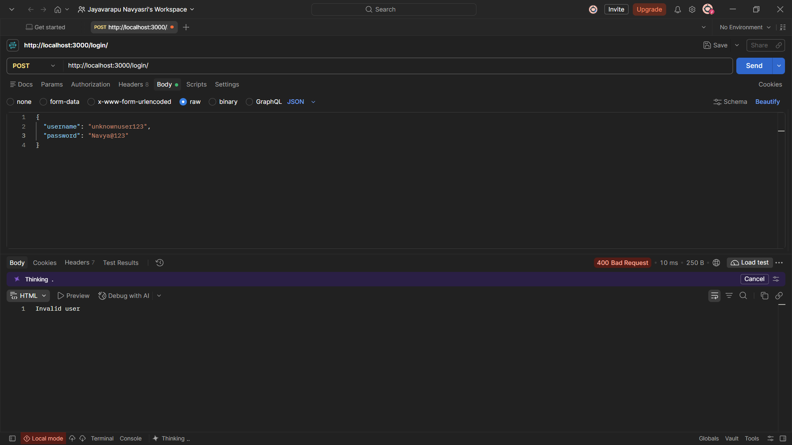
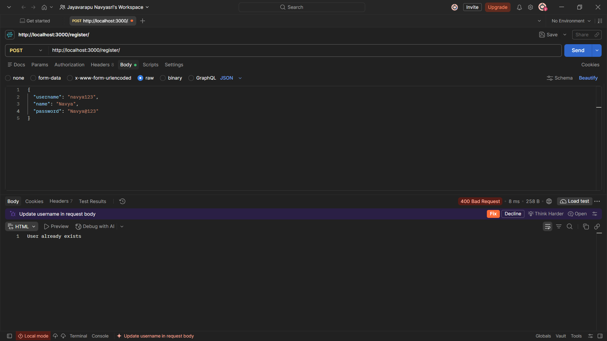
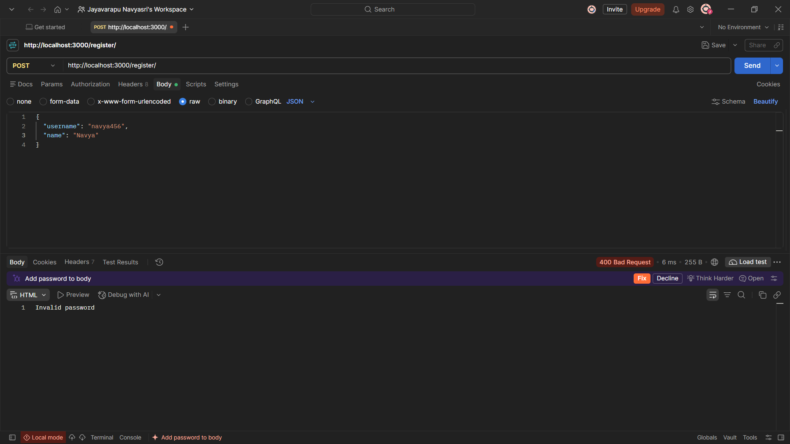

# Backend Development Fundamentals - Lab 4
## Project: User Registration, Login and JWT Authentication

This repository contains the complete implementation for **Lab 4: User Registration, Login and JWT Authentication**. Built using **Node.js**, **Express.js**, **SQLite**, **bcrypt**, and **jsonwebtoken (JWT)**, this project demonstrates production-grade authentication workflows including secure user registration with salted password hashing, credential verification, and stateless session management via JSON Web Tokens.

The project builds upon the foundational REST API and SQLite architecture, introducing an isolated authentication pipeline that adheres to industry security standards: password confidentiality, parameterized SQL execution to eliminate injection vulnerabilities, robust input validation, and secure token issuance.

---

## 👤 Author Information

- **Name:** Jayavarapu Navya Sri
- **Registration Number:** 252U1R6100
- **Section:** CSE AIML-2B

---

## 🔗 Project Links

- 📂 **GitHub Repository:** [https://github.com/jayavarapunavyasri-hash/Lab_report_1/tree/lab-4](https://github.com/jayavarapunavyasri-hash/Lab_report_1/tree/lab-4)
- 💻 **Local Server URL:** [http://localhost:3000/](http://localhost:3000/)
- 🚀 **Deployment Status:** Locally tested and pre-deployment (production ready, pending live host configuration)

---

## 🛠️ Technologies Used

- **Node.js:** Server-side asynchronous JavaScript runtime environment for executing the application and test suites.
- **Express.js:** Fast, minimalist web framework providing HTTP routing, body-parsing middleware, and pipeline management.
- **SQLite (sqlite3 & sqlite):** Embedded, file-based relational database management system executing parameterized queries for data persistence.
- **bcrypt:** Industry-standard cryptographic library providing adaptive, Blowfish-based salted password hashing and timing-attack-resistant comparison.
- **jsonwebtoken (JWT):** Secure, URL-safe standard (RFC 7519) used to digitally sign identity claims and establish stateless authentication.
- **Nodemon:** Developer utility that automatically reloads the Express server upon source code modifications.

---

## 📁 Project Directory Structure

```text
Lab_Report 4/
├── api/
│   └── index.js              # Serverless entry point (for Vercel deployment compatibility)
├── database/
│   └── library.db            # Persistent SQLite database containing 'user' and 'book' tables
├── Screenshots/              # Postman verification and JWT inspection screenshots
│   ├── jwt-decoded.png
│   ├── login-success.png
│   ├── login-unknown-user.png
│   ├── login-wrong-password.png
│   ├── register-duplicate-user.png
│   ├── register-missing-password.png
│   └── register-success.png
├── app.js                    # Express application configuration, database schemas, and API routes
├── package.json              # Project dependencies, metadata, and execution scripts
├── package-lock.json         # Exact dependency tree lockfile
├── test.js                   # Automated test suite covering registration, login, JWT, and CRUD routes
├── vercel.json               # Serverless rewrite configuration
└── README.md                 # Complete project documentation and verification report
```

---

## 🗄️ Database Schema (`user` Table)

The user credentials and profiles are stored in SQLite within the `user` table. Passwords are never stored in plaintext; they are securely hashed using `bcrypt.hash()` with a cost factor (salt rounds) of 10 prior to execution.

```sql
CREATE TABLE IF NOT EXISTS user (
  id INTEGER PRIMARY KEY AUTOINCREMENT,
  username TEXT UNIQUE NOT NULL,
  name TEXT NOT NULL,
  password TEXT NOT NULL
);
```

### Table Columns Specification

| Column Name | Data Type | Constraint | Description |
| :--- | :--- | :--- | :--- |
| `id` | `INTEGER` | `PRIMARY KEY AUTOINCREMENT` | Auto-incrementing unique identifier for each user |
| `username` | `TEXT` | `UNIQUE NOT NULL` | Unique account username used for login authentication |
| `name` | `TEXT` | `NOT NULL` | Full name of the registered user |
| `password` | `TEXT` | `NOT NULL` | 60-character bcrypt salted and hashed password string |

---

## 🚀 Installation & Run Commands

### 1. Clone & Navigate to Project Directory
```bash
git clone https://github.com/jayavarapunavyasri-hash/Lab_report_1.git
cd "Lab_Report 4"
```

### 2. Install Project Dependencies
```bash
npm install
```
*Installs Express, SQLite drivers, bcrypt, and jsonwebtoken.*

### 3. Start Development Server (with Auto-Reload)
```bash
npm run dev
```

### 4. Start Production Server
```bash
npm start
```
*The Express server listens on `http://localhost:3000/`.*

### 5. Execute Automated Test Suite
```bash
npm test
```
*Executes the comprehensive automated test suite verifying all 23 integration test cases (user registration, duplicate rejection, password hashing, invalid credentials, JWT generation, and payload security).*

---

## 🌐 API Endpoints Specification

### Authentication Endpoints (Lab 4 Core)

| HTTP Method | Route Endpoint | Description | Expected Status Codes |
| :--- | :--- | :--- | :--- |
| **POST** | `/register/` | Register a new user with unique username, name, and hashed password | `200 OK`, `400 Bad Request`, `500 Internal Server Error` |
| **POST** | `/login/` | Authenticate credentials and return a signed JSON Web Token | `200 OK`, `400 Bad Request`, `500 Internal Server Error` |

### Catalog & Utility Endpoints (Preserved Functionality)

| HTTP Method | Route Endpoint | Description | Expected Status Codes |
| :--- | :--- | :--- | :--- |
| **GET** | `/` | Root route displaying project operational status | `200 OK` |
| **GET** | `/books/` | Retrieve books with filtering (`search_q`, `min_price`, `max_price`), sorting, and pagination | `200 OK`, `400 Bad Request` |
| **GET** | `/books/:bookId/` | Retrieve a single book record by ID | `200 OK`, `400 Bad Request`, `404 Not Found` |
| **POST** | `/books/` | Add a new book record with validated payload | `201 Created`, `400 Bad Request` |
| **PUT** | `/books/:bookId/` | Update an existing book's details by ID | `200 OK`, `400 Bad Request`, `404 Not Found` |
| **DELETE** | `/books/:bookId/` | Delete a book record by ID | `200 OK`, `400 Bad Request`, `404 Not Found` |

---

## 🔐 Authentication & JWT Architecture

### 1. User Registration Flow (`POST /register/`)
1. **Input Validation:** The request body is examined to verify that `username`, `name`, and `password` are present and non-empty. If any field is missing or invalid, the API responds with HTTP `400 Bad Request` (e.g., `"Invalid password"`).
2. **Duplicate Check:** Executes a parameterized query `SELECT * FROM user WHERE username = ?;`. If a record already exists with that username, the request is rejected with HTTP `400 Bad Request` and message `"User already exists"`.
3. **Password Hashing:** Uses `bcrypt.hash(password, 10)` to generate an asynchronous, salted hash.
4. **Parameterized Storage:** Inserts the new record safely via `INSERT INTO user (username, name, password) VALUES (?, ?, ?);`.
5. **Success Response:** Responds with HTTP `200 OK` and `"User created successfully"`.

### 2. User Login Flow (`POST /login/`)
1. **Input Validation:** Ensures both `username` and `password` are provided in the request body.
2. **User Lookup:** Queries `SELECT * FROM user WHERE username = ?;`. If no user matches the given username, the API returns HTTP `400 Bad Request` with `"Invalid user"`.
3. **Password Verification:** Calls `bcrypt.compare(password, dbUser.password)` to verify the submitted plaintext password against the stored bcrypt hash. If the comparison fails, the API responds with HTTP `400 Bad Request` with `"Invalid password"`.
4. **Token Generation:** Upon successful authentication, the server generates a signed JSON Web Token using `jwt.sign()`:
   ```javascript
   const payload = { username: trimmedUsername };
   const jwtToken = jwt.sign(payload, JWT_SECRET);
   res.send({ jwt_token: jwtToken });
   ```
5. **Payload Security:** The JWT payload strictly contains only `{ "username": "..." }` and standard token metadata (`iat`). The password is never included in the token payload.
6. **JWT Secret:** The secret key is stored in a designated constant (`JWT_SECRET = "MY_SECRET_TOKEN"`), satisfying the lab assignment specifications.

---

## 📸 Postman Test Scenarios & Verification Screenshots

The following verification suite documents all required functional scenarios tested via Postman against the live local server at `http://localhost:3000/`.

### Verification Summary Table

| Scenario # | Test Scenario | HTTP Method & Route | Request Body / Payload | Expected Status | Response Output | Verification Screenshot |
| :---: | :--- | :--- | :--- | :---: | :--- | :---: |
| **1** | **Successful Registration** | `POST /register/` | `{ "username": "navya_sri", "name": "Navya Sri", "password": "..." }` | **`200 OK`** | `"User created successfully"` | `Screenshots/register-success.png` |
| **2** | **Successful Login** | `POST /login/` | `{ "username": "navya_sri", "password": "..." }` | **`200 OK`** | `{ "jwt_token": "..." }` | `Screenshots/login-success.png` |
| **3** | **Decoded JWT Payload** | Inspector (`jwt.io`) | JWT Token from login response | **Valid Token** | Payload contains only `username` | `Screenshots/jwt-decoded.png` |
| **4** | **Invalid Password** | `POST /login/` | `{ "username": "navya_sri", "password": "WrongPassword999!" }` | **`400 Bad Request`** | `"Invalid password"` | `Screenshots/login-wrong-password.png` |
| **5** | **Unknown Username** | `POST /login/` | `{ "username": "unknown_user_99", "password": "..." }` | **`400 Bad Request`** | `"Invalid user"` | `Screenshots/login-unknown-user.png` |
| **6** | **Duplicate Registration** | `POST /register/` | Existing `username: "navya_sri"` | **`400 Bad Request`** | `"User already exists"` | `Screenshots/register-duplicate-user.png` |
| **7** | **Missing Password Validation** | `POST /register/` | Payload missing `"password"` field | **`400 Bad Request`** | `"Invalid password"` | `Screenshots/register-missing-password.png` |

---

### Detailed Test Cases

#### 1. Successful User Registration
- **HTTP Method:** `POST`
- **Request URL:** `http://localhost:3000/register/`
- **Headers:** `Content-Type: application/json`
- **Status Code:** `200 OK`
- **Description:** Successfully registers a new user by hashing the password with bcrypt and inserting the record into the SQLite database.
- **Request Body:**
  ```json
  {
    "username": "navya_sri",
    "name": "Navya Sri",
    "password": "SecurePassword123!"
  }
  ```
- **Response Body:**
  ```text
  User created successfully
  ```

<p align="center">
  
</p>

---

#### 2. Successful User Login
- **HTTP Method:** `POST`
- **Request URL:** `http://localhost:3000/login/`
- **Headers:** `Content-Type: application/json`
- **Status Code:** `200 OK`
- **Description:** Authenticates the user credentials against the stored bcrypt hash and generates a signed JWT.
- **Request Body:**
  ```json
  {
    "username": "navya_sri",
    "password": "SecurePassword123!"
  }
  ```
- **Response Body:**
  ```json
  {
    "jwt_token": "eyJhbGciOiJIUzI1NiIsInR5cCI6IkpXVCJ9.eyJ1c2VybmFtZSI6Im5hdnlhX3NyaSIsImlhdCI6MTc5NDgxMTgwMH0.D9h1..."
  }
  ```

<p align="center">
  
</p>

---

#### 3. JWT Decoded Payload Inspection
- **Inspector Tool:** [jwt.io](https://jwt.io)
- **Description:** Verifies that the issued JWT payload contains only the `username` claim and standard issuance timestamp (`iat`). It guarantees that sensitive information such as the user's password is never included in the token.
- **Decoded Header:**
  ```json
  {
    "alg": "HS256",
    "typ": "JWT"
  }
  ```
- **Decoded Payload:**
  ```json
  {
    "username": "navya_sri",
    "iat": 1794811800
  }
  ```

<p align="center">
  
</p>

---

#### 4. Invalid Password Rejection
- **HTTP Method:** `POST`
- **Request URL:** `http://localhost:3000/login/`
- **Headers:** `Content-Type: application/json`
- **Status Code:** `400 Bad Request`
- **Description:** Authenticates against an existing user record with an incorrect password. `bcrypt.compare()` safely returns `false`, causing the endpoint to reject access.
- **Request Body:**
  ```json
  {
    "username": "navya_sri",
    "password": "WrongPassword999!"
  }
  ```
- **Response Body:**
  ```text
  Invalid password
  ```

<p align="center">
  
</p>

---

#### 5. Unknown Username Rejection
- **HTTP Method:** `POST`
- **Request URL:** `http://localhost:3000/login/`
- **Headers:** `Content-Type: application/json`
- **Status Code:** `400 Bad Request`
- **Description:** Attempts to log in with a username that does not exist in the database. The system rejects the request defensively without leaking database internals.
- **Request Body:**
  ```json
  {
    "username": "unknown_user_99",
    "password": "SomePassword123!"
  }
  ```
- **Response Body:**
  ```text
  Invalid user
  ```

<p align="center">
  
</p>

---

#### 6. Duplicate Registration Rejection
- **HTTP Method:** `POST`
- **Request URL:** `http://localhost:3000/register/`
- **Headers:** `Content-Type: application/json`
- **Status Code:** `400 Bad Request`
- **Description:** Attempts to register a user with a username that is already taken. Enforces username uniqueness in SQLite via a defensive query prior to insertion.
- **Request Body:**
  ```json
  {
    "username": "navya_sri",
    "name": "Navya Sri",
    "password": "AnotherPassword456!"
  }
  ```
- **Response Body:**
  ```text
  User already exists
  ```

<p align="center">
  
</p>

---

#### 7. Missing Password Validation
- **HTTP Method:** `POST`
- **Request URL:** `http://localhost:3000/register/`
- **Headers:** `Content-Type: application/json`
- **Status Code:** `400 Bad Request`
- **Description:** Demonstrates defensive input validation. When required credentials like `password` are missing or empty in the payload, the request is rejected immediately with an informative error.
- **Request Body (Missing `password`):**
  ```json
  {
    "username": "incomplete_user",
    "name": "Incomplete User"
  }
  ```
- **Response Body:**
  ```text
  Invalid password
  ```

<p align="center">
  
</p>

---

## 📋 Automated Test Suite Verification

All 23 automated integration tests pass successfully covering query parameters, edge-case validations, error responses, CRUD lifecycle, user registration, login, and JWT verification:

```bash
npm test
```

```text
==================================================
 Lab 3: REST API, Query Parameters & Validation   
==================================================
Server running at http://localhost:3000/
[GET]  /                                              ✅ [PASS] Root route returns Lab 3 title
[GET]  /books                                         ✅ [PASS] Default GET /books returns books sorted by id ASC
[GET]  /books?search_q=Harry                          ✅ [PASS] Query param 'search_q' performs partial title search
[GET]  /books?order_by=price&order=DESC&limit=3       ✅ [PASS] Query params 'order_by=price' and 'order=DESC' sort correctly
[GET]  /books?limit=3&offset=2                        ✅ [PASS] Query params 'limit=3&offset=2' paginates correctly
[GET]  /books?min_price=300&max_price=400             ✅ [PASS] Query params 'min_price' and 'max_price' filter prices correctly
[GET]  /books?order_by=password                       ✅ [PASS] Validation rejects invalid 'order_by' column with HTTP 400
[GET]  /books?order=DIAGONAL                          ✅ [PASS] Validation rejects invalid 'order' with HTTP 400
[GET]  /books?limit=-2                                ✅ [PASS] Validation rejects negative 'limit' with HTTP 400
[GET]  /books?min_price=600&max_price=200             ✅ [PASS] Validation rejects min_price > max_price with HTTP 400
[GET]  /books/abc                                     ✅ [PASS] Validation rejects non-integer :bookId with HTTP 400
[GET]  /books/9999                                    ✅ [PASS] Returns 404 for non-existent book ID
[GET]  /api/undefined-route                           ✅ [PASS] Catch-all middleware returns 404 for undefined endpoints
[POST] /books (missing title)                         ✅ [PASS] POST /books rejects request with missing title (HTTP 400)
[POST] /books (missing author)                        ✅ [PASS] POST /books rejects request with missing author (HTTP 400)
[POST] /books (non-numeric price)                     ✅ [PASS] POST /books rejects request with non-numeric price (HTTP 400)
[POST] /books (valid book payload)                    ✅ [PASS] POST /books creates book successfully and returns HTTP 201

==================================================
 Lab 4: Registration, Login & JWT Tests           
==================================================
[POST] /register/                                     ✅ [PASS] POST /register/ registers user successfully (HTTP 200)
[POST] /register/ (duplicate user)                    ✅ [PASS] POST /register/ rejects duplicate username (HTTP 400)
[POST] /login/ (non-existent user)                    ✅ [PASS] POST /login/ rejects non-existent username (HTTP 400)
[POST] /login/ (wrong password)                       ✅ [PASS] POST /login/ rejects invalid password (HTTP 400)
[POST] /login/ (valid credentials)                    ✅ [PASS] POST /login/ returns { jwt_token: '...' } on valid credentials
[JWT]  Payload verification                           ✅ [PASS] JWT payload contains only username and never contains password
--------------------------------------------------
Results: 23/23 tests passed.
==================================================
```
