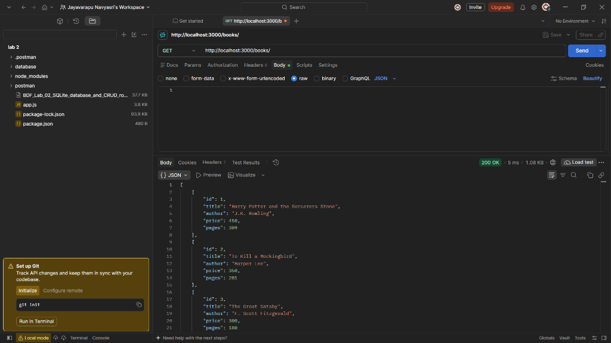
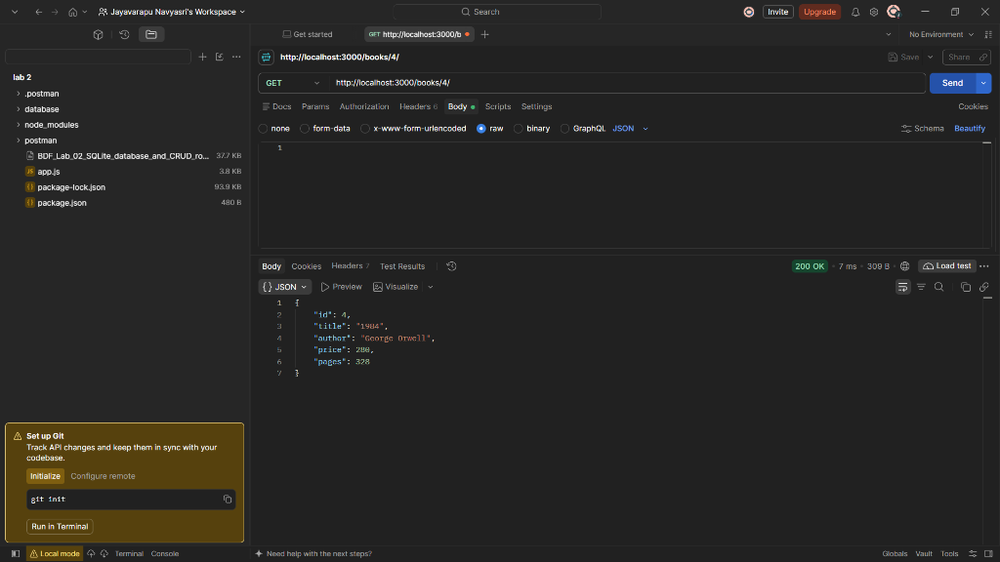
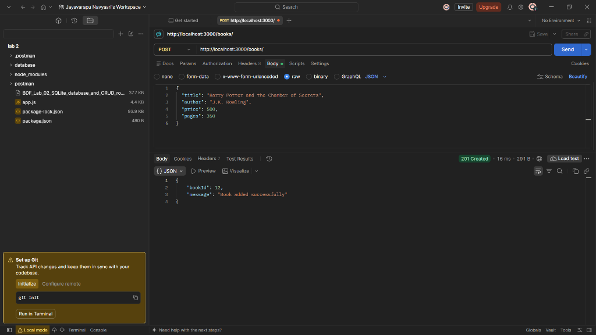
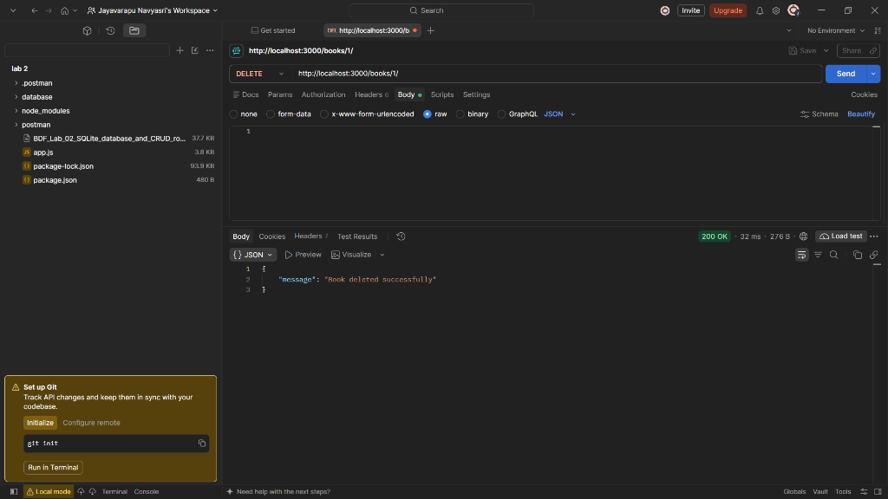

# Lab 2: SQLite database and CRUD routes

**Name:** J. Navya Sri  
**Section:** CSE AIML - 2B  
**Registration Number:** [Your Reg Number]  
**Localhost Link:** `http://localhost:3000/`  
**Base API URL:** `http://localhost:3000/books/`  

---

## How to Run

1. **Install dependencies:**
   ```bash
   npm install
   ```

2. **Verify Database:**
   ```bash
   npm run verify-db
   ```

3. **Start the Development Server:**
   ```bash
   npm run dev
   ```
   Server will start running at `http://localhost:3000/`.

---

## Endpoints

| Method | Endpoint | Localhost URL | Description |
|---|---|---|---|
| `GET` | `/books/` | `http://localhost:3000/books/` | Retrieve and return all books |
| `GET` | `/books/:bookId/` | `http://localhost:3000/books/:bookId/` | Retrieve a specific book by ID |
| `POST` | `/books/` | `http://localhost:3000/books/` | Add a new book to the database |
| `PUT` | `/books/:bookId/` | `http://localhost:3000/books/:bookId/` | Update the details of an existing book by ID |
| `DELETE` | `/books/:bookId/` | `http://localhost:3000/books/:bookId/` | Delete a book by ID |

---

## Screenshots

### 1. GET All Books (`GET /books/`)


### 2. GET Specific Book (`GET /books/:bookId/`)


### 3. POST Add Book (`POST /books/`)


### 4. PUT Update Book (`PUT /books/:bookId/`)


### 5. DELETE Book (`DELETE /books/:bookId/`)


---

## Notes: Problems Faced and Solutions
- **Empty Body on PUT / POST Requests:** Initially, sending an empty request body caused an `SQLITE_CONSTRAINT: NOT NULL constraint failed: book.title` database error. Added input validation in `app.js` to return a clear `400 Bad Request` if required fields are missing and supplied the required JSON body in Postman.
- **Server Startup Order:** Ensured that the Express server only starts listening on port 3000 after the SQLite database connection promise resolves via `initializeDBAndServer()`.

