# Backend Development Fundamentals - Lab 3

## Student Details
- Name: Jayavarapu Navya Sri
- Registration Number: 252U1R6100

## Project Description
REST API with query parameters, validation, and debugging using Node.js, Express, and SQLite.

## Local API URL
http://localhost:3000/books

## Live Deployment
Deployment pending.

## Screenshots

### 1. Default Book List (`GET /books`)
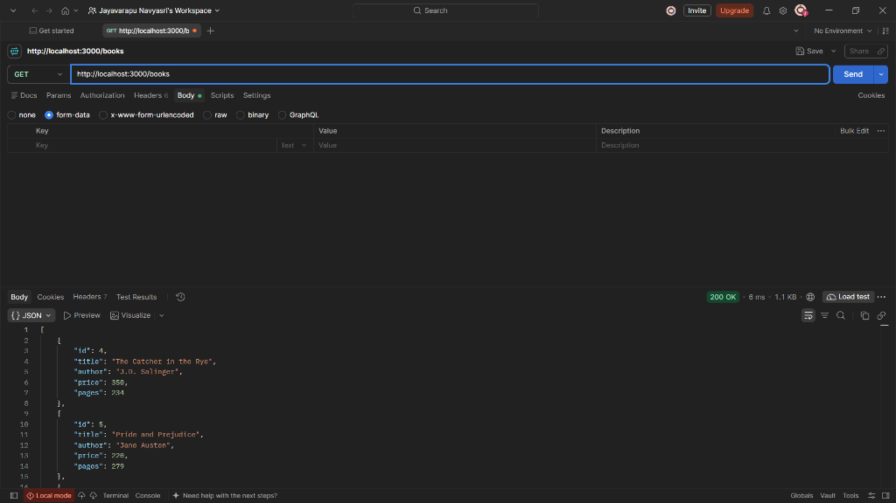

### 2. Search Books by Title (`GET /books?search_q=harry`)
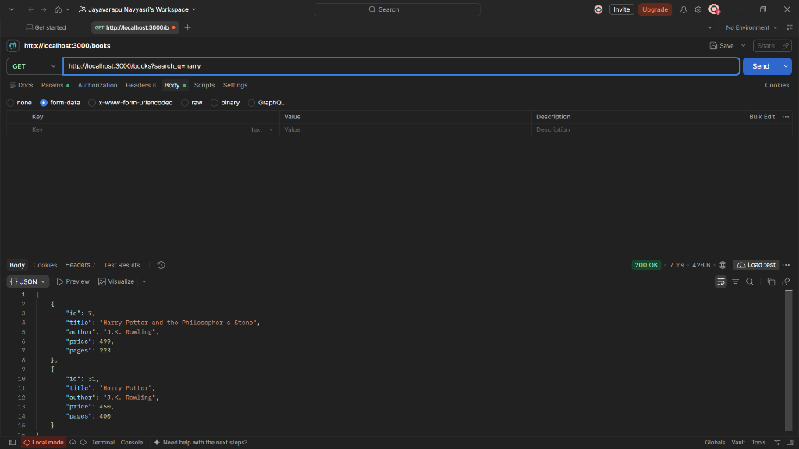

### 3. Sort by Price Descending (`GET /books?order_by=price&order=DESC`)
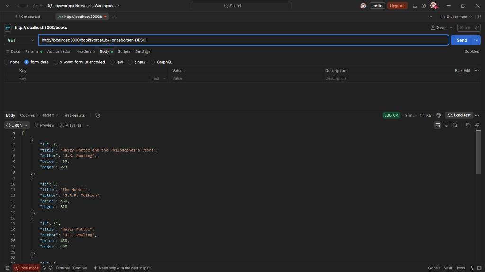

### 4. Filter by Price Range (`GET /books?min_price=100&max_price=500`)
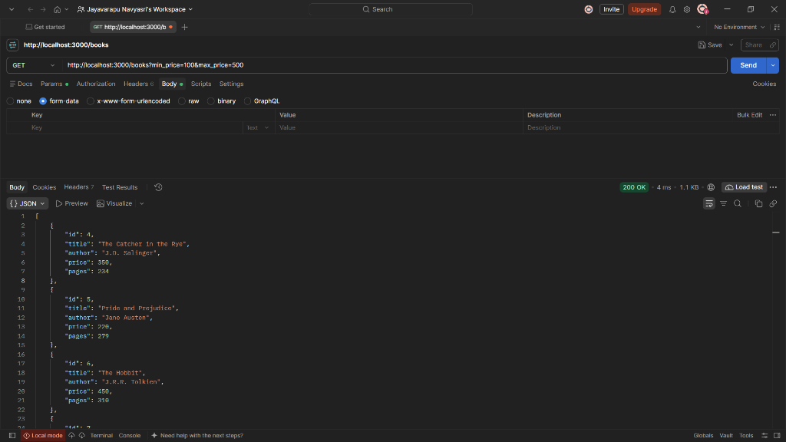

### 5. Pagination (`GET /books?limit=5&offset=0`)
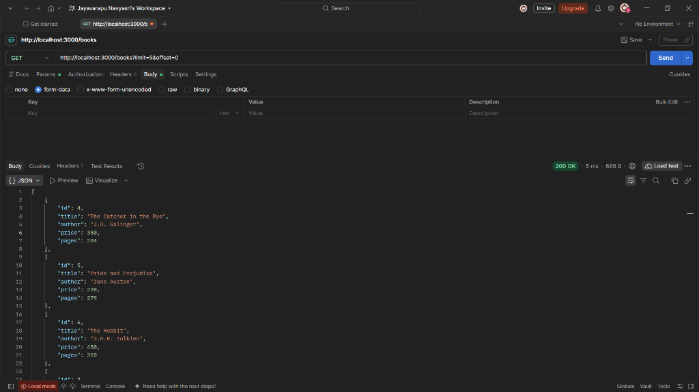

### 6. Read Single Book by ID (`GET /books/5/`)
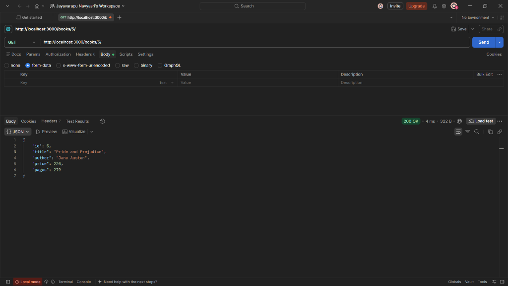

### 7. Create New Book (`POST /books`)
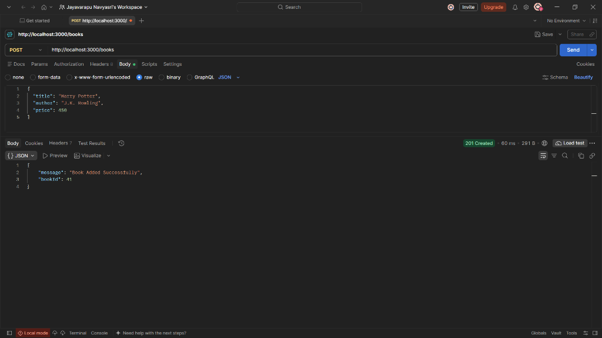

### 8. Update Non-Existent Book (`PUT /books/1` - 404 Not Found)
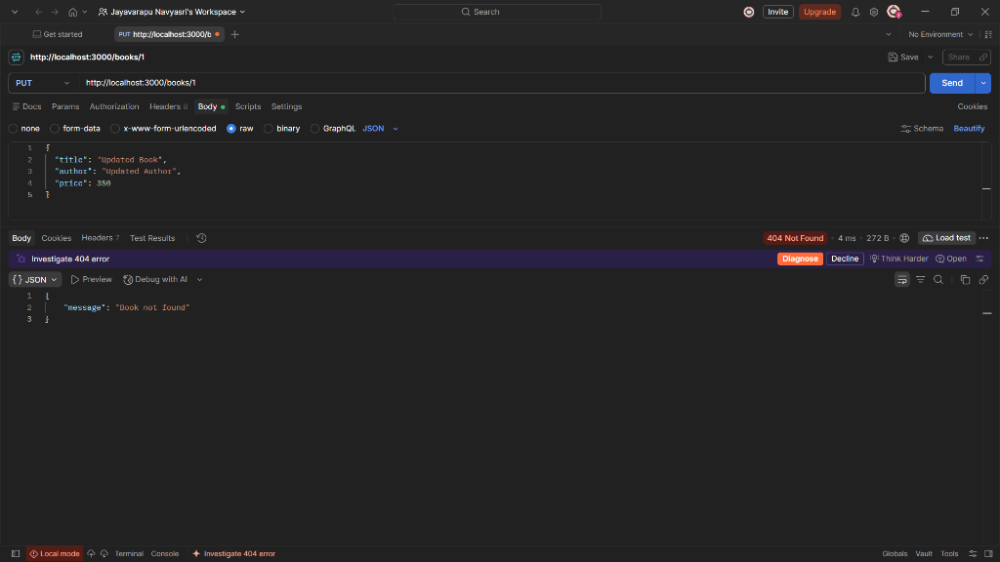

### 9. Pagination (`GET /books?limit=2&offset=0`)
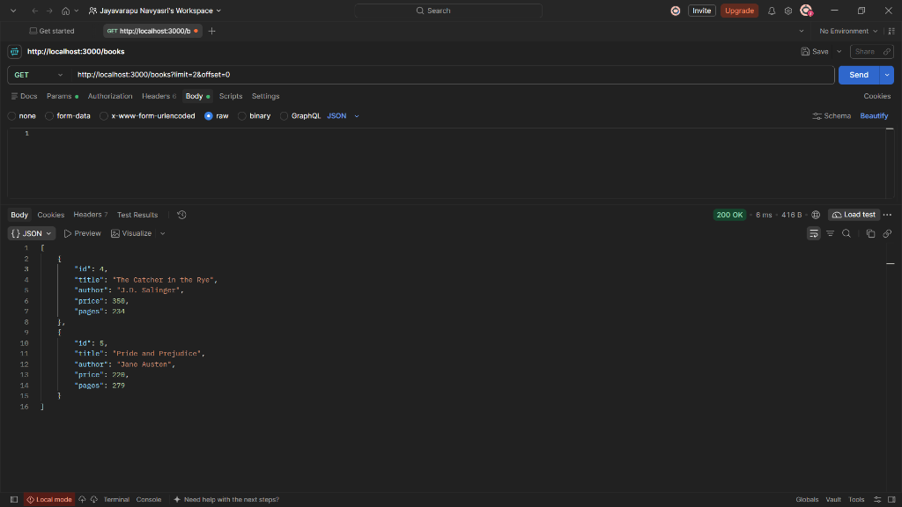

### 10. Price Range Filter (`GET /books?min_price=200&max_price=800`)
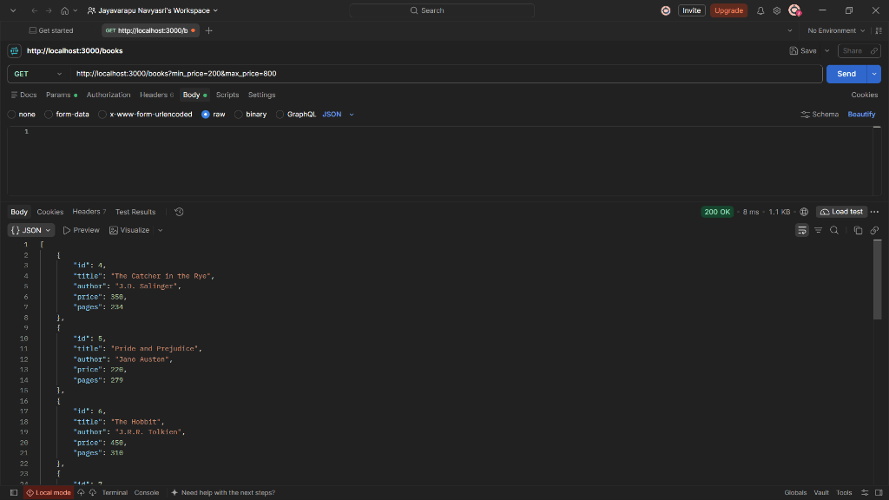

### 11. Delete Book by ID (`DELETE /books/4`)
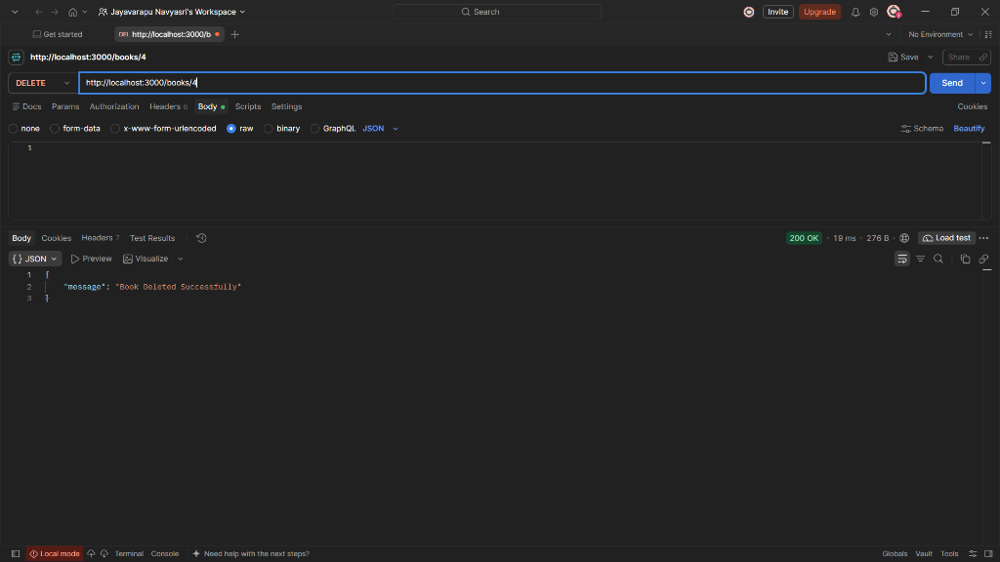
